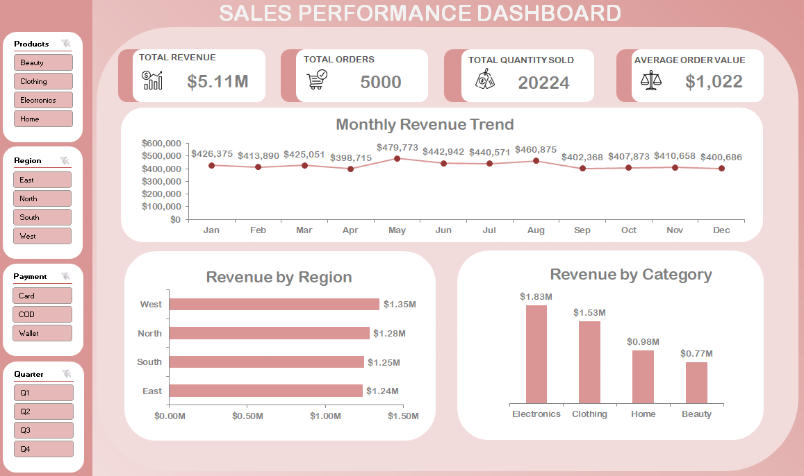

# E-Commerce Sales Performance Dashboard (Excel)

An interactive Microsoft Excel sales analytics dashboard built from a dataset of **5,000 e-commerce orders** (`$5.11M` total revenue, `20,224` units sold, and `$1,022` average order value).

## Dashboard Preview

## Key Features

- **KPI Cards:** Total Revenue (`$5.11M`), Total Orders (`5,000`), Total Quantity Sold (`20,224`), and Average Order Value (`$1,022`).
- **Interactive Slicers:** Filter across **Products** (*Beauty*, *Clothing*, *Electronics*, *Home*), **Region** (*East*, *North*, *South*, *West*), **Payment** (*Card*, *COD*, *Wallet*), and **Quarter** (*Q1*–*Q4*).
- **Visualizations:**
  - **Monthly Revenue Trend:** Revenue trajectory across *Jan*–*Dec*.
  - **Revenue by Region:** Regional revenue comparison (*West*, *North*, *South*, *East*).
  - **Revenue by Category:** Revenue breakdown by product category (*Electronics*, *Clothing*, *Home*, *Beauty*).

## Key Insights

- **Top Category:** **Electronics** leads all categories with **`$1.83M`** in revenue (**`35.8%`** of total revenue), followed by *Clothing* (`$1.53M`).
- **Top Region:** **West** generates the highest revenue at **`$1.35M`** (**`26.3%`** of total revenue), closely followed by *North* (`$1.28M`).
- **Monthly Seasonality:** **May** records the highest monthly revenue (**`$479,773`**), whereas **April** is the lowest (**`$398,715`**).
- **Payment Preference:** **Card** accounts for the largest share of revenue (**`$2.37M`**, **`46.3%`**), ahead of *COD* and *Wallet*.

## Workbook Structure

- `ecommerce_sales_analytics_5000`: Source sales records (`5,000` rows) with helper fields for month (`order_date_month`) and quarter (`order_date_quarter`).
- `Pivot`: Pivot tables and supporting summary calculations driving the KPIs and charts.
- `Dashboard`: Final interactive report layout with slicers and charts.
